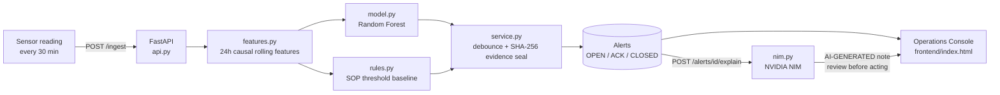
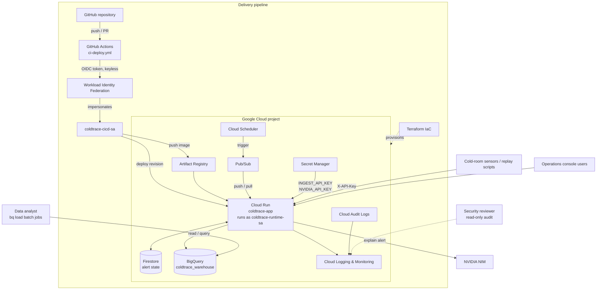
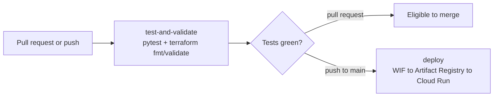

# ❄️ ColdTrace — AI Cold-Chain Operations & Spoilage Prevention Console


**Know before the product spoils.**

🔗 **Live demo:** <https://coldtrace-app-uxg3hjnrfa-uc.a.run.app/>

ColdTrace monitors refrigerated storage facilities in real time, detects temperature excursions, cooling failures and sensor dropouts before spoilage occurs, links alerts to at-risk inventory batches, and generates grounded AI incident analyses via NVIDIA NIM.

---

## About ColdTrace

Vaccines, medicines and perishable food lose value (and sometimes safety) the moment a cold room drifts out of its safe temperature band. In many distribution centers, problems such as a door left open, a failing compressor or a frozen sensor are noticed only after the inventory is already damaged, and fixed-threshold alarms fire so often that operators learn to ignore them.

ColdTrace is a cold-chain operations console that closes that gap. It ingests sensor readings every 30 minutes, scores them with a Random Forest anomaly detector alongside an SOP threshold baseline, and raises debounced alerts that move through an `OPEN → ACKNOWLEDGED → CLOSED` lifecycle. Each alert is sealed with a SHA-256 evidence hash over the exact triggering readings, so the record is tamper-evident. Operators can optionally request an NVIDIA NIM incident note, which is always labeled **AI-GENERATED, REVIEW BEFORE ACTING** and never acts on a case by itself.

**What it gives you**

- Early detection of temperature excursions, cooling failures and sensor dropouts across multiple sites.
- Fewer false alarms through causal rolling features and alert debouncing.
- A calm, dark-mode control-room dashboard served directly by FastAPI.
- Tamper-evident evidence trails for quality reviewers and compliance auditors.
- A serverless, free-tier-first Google Cloud foundation, defined entirely in Terraform and deployed through keyless CI/CD.

**Built with:** Python 3.12, FastAPI, scikit-learn (Random Forest), NVIDIA NIM, Google Cloud Run, Firestore, BigQuery, Pub/Sub, Secret Manager, Terraform and GitHub Actions with Workload Identity Federation.

---

## 📑 Table of Contents

0. [About ColdTrace](#about-coldtrace)
1. [Problem, Audience & SDG Alignment](#1-problem-audience--sdg-alignment)
2. [System Architecture](#2-system-architecture)
3. [Repository Structure](#3-repository-structure)
4. [Detection Model & Exception Types](#4-detection-model--exception-types)
5. [Team, Roles & Responsibilities](#5-team-roles--responsibilities)
6. [IAM Access Matrix & Service Accounts](#6-iam-access-matrix--service-accounts)
7. [CI/CD & Infrastructure as Code](#7-cicd--infrastructure-as-code)
8. [Cost, Quota & Free-Tier Guardrails](#8-cost-quota--free-tier-guardrails)
9. [Data Warehouse Conventions](#9-data-warehouse-conventions)
10. [Environment Configuration & Secrets](#10-environment-configuration--secrets)
11. [Local Setup & Running Instructions](#11-local-setup--running-instructions)
12. [Google Cloud Run Deployment](#12-google-cloud-run-deployment)
13. [API Reference](#13-api-reference)
14. [Security & Design Guardrails](#14-security--design-guardrails)
15. [Security Practices & Secret Handling](#15-security-practices--secret-handling)
16. [Ownership Summary (RACI)](#16-ownership-summary-raci)

---

## 1. Problem, Audience & SDG Alignment

| | |
|---|---|
| **Target audience** | Cold-chain operations leads, quality reviewers and compliance auditors managing regional distribution centers: `JHB-DC01` (Johannesburg), `DBN-DC02` (Durban), `CPT-DC03` (Cape Town). |
| **Problem** | Temperature excursions above 8 °C, compressor failures and frozen sensors are often discovered only after inventory is damaged, while high false-alarm rates cause alert fatigue. |
| **SDG alignment** | **SDG 3 — Good Health and Well-Being.** Prevents spoilage of temperature-sensitive vaccines, medicines and perishable food by enabling human intervention within minutes. |

---

## 2. System Architecture

ColdTrace combines a **Random Forest streaming anomaly detector**, **SHA-256 tamper-evident evidence hashing**, an **NVIDIA NIM incident explanation client**, and a **calm control-room web dashboard** served directly by FastAPI, deployed on a serverless, free-tier-first Google Cloud foundation.

### 2.1 Application data flow



### 2.2 Cloud platform architecture



### 2.3 Component responsibilities

| Component | Purpose |
|---|---|
| **FastAPI (`api.py`)** | Serves the dashboard, authenticates requests, exposes ingest/alert/explain endpoints. |
| **Feature engine (`features.py`)** | Causal 24-hour rolling features; no look-ahead leakage. |
| **Detector (`model.py`, `rules.py`)** | Random Forest classifier plus SOP fixed-threshold baseline for comparison. |
| **Service layer (`service.py`)** | Streaming state, debouncing, alert lifecycle and SHA-256 evidence sealing. |
| **NIM client (`nim.py`)** | Generates strict-JSON, schema-validated incident notes via NVIDIA NIM. |
| **Cloud Run** | Single scale-to-zero container serving API and web UI. |
| **Pub/Sub + Cloud Scheduler** | Serverless scheduled and asynchronous pipelines. |
| **Firestore** | Persistent alert and case state (replaces in-memory state for multi-instance use). |
| **BigQuery (`coldtrace_warehouse`)** | Telemetry and anomaly history for analysis and trend validation. |
| **Secret Manager** | Holds `INGEST_API_KEY` and `NVIDIA_API_KEY`; injected at runtime. |
| **Artifact Registry** | Stores container images built by CI/CD. |
| **Terraform** | Declares all infrastructure, IAM bindings, budgets and guardrails. |
| **GitHub Actions + WIF** | Keyless build, push and deploy through a single `ci-deploy.yml` workflow. |

---

## 3. Repository Structure

```text
coldtrace/
├── README.md               # Project overview, team & setup guide
├── env.example             # Sample environment variables (never commit .env)
├── terraform/              # Infrastructure as Code (project, IAM, WIF, budget, services)
├── .github/
│   └── workflows/
│       └── ci-deploy.yml   # Single pipeline: tests, Terraform validate, WIF deploy to Cloud Run
└── Backend/
    ├── coldtrace/
    │   ├── api.py          # FastAPI server, dashboard routes, auth & NIM endpoints
    │   ├── features.py     # Causal rolling features (24h baseline window)
    │   ├── model.py        # Random Forest classifier & model artifact loader
    │   ├── rules.py        # SOP fixed-threshold baseline detector
    │   ├── service.py      # Streaming state, debouncing & SHA-256 evidence sealing
    │   ├── nim.py          # NVIDIA NIM client with strict JSON schema validation
    │   └── evaluate.py     # Event-level recall, TTD & false-alert metrics
    ├── frontend/
    │   └── index.html      # Dark-mode operations console (#0B1220 / #38BDF8 design system)
    ├── data/
    │   └── sample_14d.csv  # 14-day synthetic telemetry for local & cloud demo replay
    ├── artifacts/          # Trained Random Forest model artifacts
    ├── scripts/
    │   ├── generate_data.py # Synthetic multi-site telemetry generator (2022–2026)
    │   ├── train_eval.py    # Trains & benchmarks threshold vs. rules vs. Random Forest
    │   ├── replay.py        # Replays CSV telemetry locally or against live HTTP API
    │   └── compare_nim.py   # Benchmarks NVIDIA NIM models on labeled windows
    ├── tests/              # Automated unit tests (pytest)
    ├── Dockerfile          # Production container for Google Cloud Run
    └── requirements.txt    # Python 3.12 dependencies
```

---

## 4. Detection Model & Exception Types

| Exception type | Sensor signature | Operational action |
|---|---|---|
| `TEMP_EXCURSION` | Temperature leaves the 2–8 °C safe band (door left open / power loss); cooling load rises. | Inspect unit immediately; relocate or protect at-risk batches. |
| `COOLING_FAILURE` | Temperature drifts upward while cooling load is abnormally low (compressor fault). | Dispatch maintenance; transfer high-sensitivity inventory. |
| `SENSOR_DROPOUT` | Sensor connectivity drops and temperature/humidity readings freeze. | Verify temperature manually; treat unit status as unknown. |

### Benchmark results

| Metric | Result |
|---|---|
| Random Forest event recall | **94%** |
| Median excursion time-to-detect (TTD) | **0.5 h** |
| Cooling failure TTD | **1.0 h** |
| False alerts | **~0.11 per location-day** |

> **Note:** These metrics are derived from simulated data to validate pipeline performance.

---

## 5. Team, Roles & Responsibilities

| Member | Role | Primary focus |
|---|---|---|
| **Moorthy R** | DevOps & Cloud Owner | GCP project, billing, Terraform, CI/CD, secrets, reliability |
| **Chantell Ntokozo** | Data Analyst | BigQuery data loading, partition-aware querying, telemetry validation |
| **Mbambala T** | AI & Cloud Foundation Engineer | AI/ML pipeline, container builds, Cloud Run, Pub/Sub, Scheduler, Firestore |
| **Dr. Peter Opiyo** | Cyber Security Reviewer | Read-only audit of IAM, WIF, logs, monitoring and evidence integrity |

### 5.1 DevOps & Cloud Owner — Moorthy R

**Contact:** `moorthyrtmp@gmail.com`

**Roles**
- Project Owner
- Billing Account Administrator

**Responsibilities**
- Owns the GCP project, the billing account and the **`$1/month` budget guardrail**.
- Manages **Terraform** infrastructure as code.
- Manages the **GitHub Actions CI/CD** pipeline (`ci-deploy.yml`) with **Workload Identity Federation** (keyless authentication).
- Manages **Secret Manager** secret creation and rotation.
- Oversees cost and quota limits and overall **production reliability**.
- Delivers the local/WSL environment setup, API workflow endpoints, full-stack console integration and Cloud Run deployment.

### 5.2 Data Analyst — Chantell Ntokozo

**Contact:** `ntokozochantell396@gmail.com`

**Roles**
- `roles/bigquery.jobUser` (project-level)
- `roles/bigquery.dataEditor` (scoped to the `coldtrace_warehouse` dataset only)

**Responsibilities**
- Feeds cold-chain telemetry into `coldtrace_warehouse` using **free batch load jobs (`bq load`)** instead of paid streaming inserts.
- Queries data using **partition filters on `Timestamp`**, staying within query byte and daily limits.
- Validates telemetry quality and anomaly trends through BigQuery and the ColdTrace read endpoints.
- Delivers data schema validation, 30-minute cadence checks and flat-run (sensor dropout) verification.

### 5.3 AI & Cloud Foundation Engineer — Mbambala T

**Contact:** `mbambalat@gmail.com`

**Roles (project-level)**
- `roles/run.developer`
- `roles/artifactregistry.writer`
- `roles/pubsub.editor`
- `roles/cloudscheduler.admin`
- `roles/datastore.user`
- `roles/bigquery.jobUser`
- `roles/bigquery.dataViewer`
- `roles/secretmanager.viewer`
- `roles/iam.serviceAccountUser`

**Responsibilities**
- Builds and deploys ColdTrace container images to **Artifact Registry** and **Cloud Run**.
- Maintains serverless pipelines across **Pub/Sub, Cloud Scheduler, Firestore, BigQuery** and AI inference endpoints.
- Keeps **free-tier scaling guardrails** intact (scale-to-zero, instance caps, memory limits).
- Works **without access to plaintext secrets** (`secretmanager.viewer` allows metadata only).
- Delivers the AI research foundations, synthetic dataset simulator, Random Forest baseline and evaluation, NVIDIA NIM integration and frontend build brief.

### 5.4 Cyber Security Reviewer — Dr. Peter Opiyo

**Contact:** `drpeteropiyo@gmail.com`

**Roles (project-level, read-only)**
- `roles/iam.securityReviewer`
- `roles/logging.viewer`
- `roles/logging.privateLogViewer`
- `roles/monitoring.viewer`
- `roles/secretmanager.viewer`
- `roles/bigquery.dataViewer`
- `roles/bigquery.jobUser`

**Responsibilities**
- Audits **IAM bindings**, **WIF trust rules**, authentication/authorization rejections and **Cloud Audit Logs**.
- Reviews **Cloud Monitoring** alerts and **evidence integrity** (`evidence_sha256`).
- Operates in a **read-only audit capacity**: no write permissions and no access to raw secret values.
- Delivers API key security (`X-API-Key` constant-time verification), secret management practices and role-based access review.

---

## 6. IAM Access Matrix & Service Accounts

### 6.1 Human access matrix

| Role | Moorthy R | Chantell N. | Mbambala T | Dr. Peter O. |
|---|:---:|:---:|:---:|:---:|
| Project Owner | ✅ | | | |
| Billing Account Administrator | ✅ | | | |
| `bigquery.jobUser` | | ✅ | ✅ | ✅ |
| `bigquery.dataEditor` (`coldtrace_warehouse` only) | | ✅ | | |
| `bigquery.dataViewer` | | | ✅ | ✅ |
| `run.developer` | | | ✅ | |
| `artifactregistry.writer` | | | ✅ | |
| `pubsub.editor` | | | ✅ | |
| `cloudscheduler.admin` | | | ✅ | |
| `datastore.user` | | | ✅ | |
| `iam.serviceAccountUser` | | | ✅ | |
| `secretmanager.viewer` (metadata only) | | | ✅ | ✅ |
| `iam.securityReviewer` | | | | ✅ |
| `logging.viewer` / `logging.privateLogViewer` | | | | ✅ |
| `monitoring.viewer` | | | | ✅ |

### 6.2 Service accounts

| Service account | Used by | Permissions (least privilege) |
|---|---|---|
| `coldtrace-runtime-sa` | Cloud Run service | Firestore, Pub/Sub, BigQuery (read/query), Cloud Logging & Monitoring, and **only the required Secret Manager secrets**. |
| `coldtrace-cicd-sa` | GitHub Actions | Authenticates **keylessly via Workload Identity Federation**; pushes images to Artifact Registry and deploys Cloud Run revisions. No long-lived keys. |

---

## 7. CI/CD & Infrastructure as Code

**Owner:** Moorthy R (with Mbambala T for build and deploy specifics)

The whole pipeline lives in **one workflow file: `.github/workflows/ci-deploy.yml`**.

```text
git push ──► GitHub Actions (ci-deploy.yml) ──► OIDC token ──► Workload Identity Federation
                                                                      │
                                                         impersonate coldtrace-cicd-sa
                                                                      │
                                        ┌─────────────────────────────┴───────────────┐
                                        ▼                                             ▼
                              Build & push image                          Deploy Cloud Run revision
                              to Artifact Registry                        (runs as coldtrace-runtime-sa)
```

- **No service-account JSON keys** exist anywhere; GitHub authenticates through short-lived OIDC tokens.
- WIF trust rules are scoped to this repository so other repos cannot impersonate the CI/CD identity.
- **Terraform** is the single source of truth for APIs, service accounts, IAM bindings, WIF, budget alerts and Cloud Run guardrails.
- Secrets are rotated in **Secret Manager**; Cloud Run reads the latest version at runtime.
- Dr. Peter Opiyo periodically reviews the Terraform-declared IAM and WIF rules against the live project state.

### 7.1 Pipeline stages

`ci-deploy.yml` runs on every push and pull request. The `test-and-validate` job always runs; the `deploy` job runs only on `main` and only after `test-and-validate` passes.



### 7.2 Workflow: `ci-deploy.yml`

| Job | Triggers | What it does | Blocks merge? | Owner |
|---|---|---|---|---|
| `test-and-validate` | push to `main`, pull request, manual | Installs dependencies, runs `pytest`, then Terraform `fmt` and `validate` | Yes | Moorthy R |
| `deploy` | push to `main` (after `test-and-validate` passes), manual | Authenticates through WIF, builds and pushes the image to Artifact Registry, deploys a new Cloud Run revision | n/a (runs after merge) | Moorthy R / Mbambala T |

### 7.3 GitHub secrets used by the pipeline

| Secret (Settings → Secrets and variables → Actions) | Used by | Notes |
|---|---|---|
| `GCP_PROJECT_ID` | deploy job | Project identifier; not a credential, but kept as a secret to avoid exposing infrastructure details. |
| `GCP_WIF_PROVIDER` | deploy job | Full Workload Identity Provider resource name. |
| `GCP_CICD_SA` | deploy job | Email of `coldtrace-cicd-sa`. |

- There is **no service-account JSON key** in GitHub or anywhere else. Authentication is a short-lived OIDC token exchanged through WIF.
- `INGEST_API_KEY` and `NVIDIA_API_KEY` for production live in **Secret Manager**, never in GitHub.
- The values `change-me-local-only` and `dummy-key-for-tests` that appear in the workflow and tests are dummy placeholders with no access to anything.
- The workflow uses minimal permissions: `contents: read` by default, with `id-token: write` granted only to the deploy job so it can request the OIDC token.

### 7.4 Branch protection (Settings → Branches → rule for `main`)

Enable:
- Require a pull request before merging.
- Require the status check `test-and-validate` to pass.
- Require branches to be up to date before merging.
- Block force pushes and deletions.

Owner: Moorthy R. Reviewer: Dr. Peter Opiyo.

### 7.5 Lock down the Workload Identity trust rule

Restrict the provider so only this repository (and optionally only `main`) can impersonate `coldtrace-cicd-sa`. In Terraform (illustrative, adapt to the real resource names):

```hcl
resource "google_iam_workload_identity_pool_provider" "github" {
  # ...existing arguments...
  attribute_mapping = {
    "google.subject"       = "assertion.sub"
    "attribute.repository" = "assertion.repository"
    "attribute.ref"        = "assertion.ref"
  }
  attribute_condition = "assertion.repository == 'Muedi-M/ColdTrace'"
}
```

Dr. Peter Opiyo reviews this condition as part of the WIF audit.

---

## 8. Cost, Quota & Free-Tier Guardrails

| Guardrail | Setting | Owner |
|---|---|---|
| Monthly budget | `$1/month` with alert thresholds | Moorthy R |
| Cloud Run idle cost | `--min-instances 0` (scale-to-zero) | Mbambala T |
| Cloud Run cap | `--max-instances 1`, `--memory 512Mi` | Mbambala T |
| BigQuery loading | Free batch `bq load` only; **no streaming inserts** | Chantell Ntokozo |
| BigQuery querying | Partition filter on `Timestamp`; byte and daily query limits | Chantell Ntokozo |
| Secrets | Secret Manager only; no plaintext access for engineers | Moorthy R / Dr. Peter Opiyo |
| Cost & quota review | Ongoing monitoring of usage and quotas | Moorthy R |

---

## 9. Data Warehouse Conventions

Dataset: **`coldtrace_warehouse`** (BigQuery)

1. **Load method:** use batch load jobs.
   ```bash
   bq load --source_format=CSV --skip_leading_rows=1 \
     coldtrace_warehouse.telemetry ./data/sample_14d.csv
   ```
2. **Partitioning:** tables are partitioned on `Timestamp`; every query must filter on it.
   ```sql
   SELECT location_id, AVG(temperature_c) AS avg_temp
   FROM `coldtrace_warehouse.telemetry`
   WHERE Timestamp BETWEEN TIMESTAMP('2026-11-01') AND TIMESTAMP('2026-11-14')
   GROUP BY location_id;
   ```
3. **Access:** only the Data Analyst has write access (`dataEditor`, dataset-scoped). Everyone else is read-only; the Cloud Run runtime reads and queries only.
4. **Validation:** confirm 30-minute cadence, schema conformity and flat-run sensor dropouts before data is trusted for trend analysis.

> Table and column names above are illustrative; match them to the deployed schema.

---

## 10. Environment Configuration & Secrets

Secrets are injected via environment variables (locally via `Backend/.env`, in production via **Secret Manager** bound to Cloud Run) and are **never committed** to source control.

| Variable | Required | Description |
|---|---|---|
| `INGEST_API_KEY` | ✅ Yes | Shared API key required in the `X-API-Key` header for `/ingest`, `/alerts/{id}/explain` and case mutation routes. |
| `NVIDIA_API_KEY` | ✅ Yes | NVIDIA NGC API key used by `coldtrace/nim.py` to generate grounded incident notes. |
| `NIM_MODEL` | Optional | NVIDIA NIM model ID (defaults to `nim.DEFAULT_MODELS[0]`). |
| `NIM_TIMEOUT` | Optional | Request timeout in seconds for NVIDIA NIM calls (default: `120`). |
| `MODEL_PATH` | Optional | Path to the trained Random Forest `.joblib` artifact. |

---

## 11. Local Setup & Running Instructions

### Prerequisites

- Python 3.12+ (WSL Ubuntu 24.04, Linux or macOS)

### Step-by-step local launch

**1. Create and activate the virtual environment**

```bash
cd Backend
python3 -m venv .venv
source .venv/bin/activate
pip install -r requirements.txt
```

**2. Configure environment variables**

```bash
cp ../env.example .env
# Edit .env and set your INGEST_API_KEY and NVIDIA_API_KEY
export $(grep -v '^#' .env | xargs)
```

**3. Start the full-stack server (API + web dashboard)**

```bash
uvicorn coldtrace.api:app --reload --port 8000
```

**4. Open the application**

| What | URL |
|---|---|
| Operations Console UI | <http://localhost:8000> |
| Interactive API docs (Swagger) | <http://localhost:8000/docs> |

In the console, click **Simulate 14d Feed** to replay `sample_14d.csv`, inspect alerts, acknowledge or close cases, and click **Generate AI Note**.

**5. Run the unit tests**

```bash
pytest -q tests
```

---

## 12. Google Cloud Run Deployment

The included `Backend/Dockerfile` packages both the FastAPI backend and the `frontend/index.html` dashboard into a single container that runs within Cloud Run's Always Free tier (scale-to-zero when idle). Production deployments are normally performed by **GitHub Actions** through `ci-deploy.yml` (see [section 7](#7-cicd--infrastructure-as-code)); the manual path below is for bootstrap and troubleshooting.

**1. Authenticate and enable the required GCP APIs**

```bash
gcloud init
gcloud services enable run.googleapis.com cloudbuild.googleapis.com artifactregistry.googleapis.com
```

**2. Make sure the Dockerfile copies the frontend**

Verify that `COPY frontend ./frontend` (or `COPY . .`) is present in `Backend/Dockerfile`.

**3. Deploy to Cloud Run** (`--min-instances 0` for $0 idle cost)

```bash
cd Backend
gcloud run deploy coldtrace-app \
  --source . \
  --region us-central1 \
  --allow-unauthenticated \
  --min-instances 0 \
  --max-instances 1 \
  --memory 512Mi \
  --service-account coldtrace-runtime-sa@<PROJECT_ID>.iam.gserviceaccount.com \
  --set-secrets "INGEST_API_KEY=INGEST_API_KEY:latest,NVIDIA_API_KEY=NVIDIA_API_KEY:latest"
```

> 💡 Secrets are stored in **Secret Manager** and bound with `--set-secrets`. Avoid `--set-env-vars` for keys, since plaintext values appear in service configuration.

**4. Verify the cloud deployment**

Open the generated `https://coldtrace-app-xxxxx-uc.a.run.app` HTTPS URL, enter your `INGEST_API_KEY` in the header bar, and click **Simulate 14d Feed**.

---

## 13. API Reference

| Method & path | Auth (`X-API-Key`) | Purpose |
|---|---|---|
| `GET /` | Public | Serves the ColdTrace Operations Console web UI. |
| `GET /healthz` | Public | Health check and active location list. |
| `POST /ingest` | **Required** | Ingests a 30-min sensor reading, updates rolling features and raises alerts (`warming_up` for the first 50 readings per location). |
| `POST /alerts/{id}/explain` | **Required** | Calls NVIDIA NIM to produce a schema-validated incident explanation grounded in `evidence_sha256` (returns `503` if NIM is unreachable while keeping the alert valid). |
| `GET /api/locations` | Optional | Returns current status and latest telemetry for `JHB-DC01`, `DBN-DC02` and `CPT-DC03`. |
| `GET /api/alerts` | Optional | Lists all detected alerts with `evidence_sha256` and lifecycle state (`OPEN`, `ACKNOWLEDGED`, `CLOSED`). |
| `POST /api/alerts/{id}/ack` | **Required** | Transitions an alert from `OPEN` to `ACKNOWLEDGED`. |
| `POST /api/alerts/{id}/close` | **Required** | Transitions an alert to `CLOSED`. |
| `POST /api/demo/replay` | **Required** | Replays `data/sample_14d.csv` into the streaming detector for live demonstrations. |

<details>
<summary><b>Example: ingest a reading</b></summary>

```bash
curl -X POST http://localhost:8000/ingest \
  -H "Content-Type: application/json" \
  -H "X-API-Key: $INGEST_API_KEY" \
  -d '{
        "location_id": "JHB-DC01",
        "timestamp": "2026-11-13T08:30:00Z",
        "temperature_c": 9.4,
        "humidity_pct": 61.2,
        "cooling_load_pct": 78.0
      }'
```

> Field names above are illustrative. Check `/docs` for the exact request schema.

</details>

---

## 14. Security & Design Guardrails

- **AI safety:** Detection never depends on the LLM. Every NVIDIA NIM note is explicitly labeled **"AI-GENERATED, REVIEW BEFORE ACTING"** and cannot automatically acknowledge or close a case.
- **Tamper-evident evidence:** Each alert computes a deterministic `evidence_sha256` over the exact triggering sensor rows.
- **Authentication:** `X-API-Key` is verified with constant-time comparison.
- **Keyless CI/CD:** GitHub Actions uses Workload Identity Federation; no long-lived service-account keys.
- **Least privilege:** The runtime service account and every human role are scoped to the minimum required; the security reviewer is strictly read-only.
- **Secrets:** Stored in Secret Manager and injected at runtime; engineers hold `secretmanager.viewer` (metadata) only, never raw values.
- **Auditability:** Cloud Audit Logs and Cloud Monitoring alerts are reviewed by the Cyber Security Reviewer.
- **Security hygiene:** Secret handling, rotation and local pre-push checks are documented in [section 15](#15-security-practices--secret-handling).
- **Persistence:** Firestore provides durable alert state across container restarts and instances. If Firestore is not configured, state falls back to in-memory and resets on cold start.

---

## 15. Security Practices & Secret Handling

### 15.1 Layers at a glance

| Layer | Control | Where it applies |
|---|---|---|
| Secrets | Secret Manager, `.gitignore`d `.env`, placeholder-only `env.example`, GitHub secret scanning and push protection | Repo settings and GCP |
| CI/CD identity | Workload Identity Federation, no JSON keys, repo-scoped trust rule | `ci-deploy.yml` and Terraform |
| Code quality | `pytest` and Terraform `fmt`/`validate` on every push and pull request | `ci-deploy.yml` |
| Dependencies | `pip-audit` run locally before pushing | Developer machine |
| Runtime | Cloud Audit Logs, Cloud Monitoring | Managed in GCP |

### 15.2 Secret security

**Rules**
1. Never commit real values. `env.example` holds placeholders only; `.env` is in `.gitignore`.
2. Production secrets (`INGEST_API_KEY`, `NVIDIA_API_KEY`) live only in **Secret Manager** and are bound to Cloud Run with `--set-secrets`.
3. Only `coldtrace-runtime-sa` can read secret values. Engineers and the auditor hold `secretmanager.viewer` (metadata only).
4. CI uses short-lived OIDC credentials through WIF, so there is no key file to leak.
5. Turn on GitHub **Secret scanning** and **Push protection** (Settings → Code security) so leaks are blocked before they reach the repo.

**Rotation procedure** (owner: Moorthy R)
```bash
# 1. Create a new secret version
printf '%s' "<NEW_VALUE>" | gcloud secrets versions add INGEST_API_KEY --data-file=-

# 2. Roll out: a new Cloud Run revision reads ":latest"
gcloud run services update coldtrace-app --region us-central1 --update-secrets INGEST_API_KEY=INGEST_API_KEY:latest

# 3. After verifying, disable the old version
gcloud secrets versions list INGEST_API_KEY
gcloud secrets versions disable <OLD_VERSION_ID> --secret INGEST_API_KEY
```

**If a secret is leaked**
1. Revoke or rotate it immediately (above); for the NVIDIA key, regenerate it in NGC.
2. Check Cloud Audit Logs and Cloud Run request logs for misuse (Dr. Peter Opiyo).
3. Remove it from git history (`git filter-repo` or BFG), then force-push after coordinating with the team. Rotation is the real fix; history cleanup only reduces further exposure.
4. Record what happened and how it was caught.

### 15.3 Local pre-push checklist

Run these on your machine before opening a pull request. They are optional helpers and are not part of `ci-deploy.yml`.

```bash
cd Backend && pytest -q tests && cd ..
pip install pip-audit && pip-audit -r Backend/requirements.txt
gitleaks detect --source . --redact --verbose
terraform -chdir=terraform fmt -check -recursive
```

> `fastapi` and `starlette` are pinned to compatible ranges so the Starlette `TestClient` keeps working. Raise the pins deliberately in a pull request, never implicitly.

---

## 16. Ownership Summary (RACI)

**R** = Responsible, **A** = Accountable, **C** = Consulted, **I** = Informed

| Area | Moorthy R | Chantell N. | Mbambala T | Dr. Peter O. |
|---|:---:|:---:|:---:|:---:|
| GCP project, billing & `$1/month` budget | **A/R** | I | I | I |
| Terraform IaC | **A/R** | | C | C |
| GitHub Actions CI/CD (`ci-deploy.yml`) & WIF | **A/R** | | C | C |
| Secret Manager & rotation | **A/R** | | I | C |
| Container build & Cloud Run deploy | A | | **R** | I |
| Pub/Sub, Scheduler, Firestore pipelines | A | | **R** | I |
| AI model, NIM integration & evaluation | I | C | **A/R** | I |
| BigQuery loading (`bq load`) & schema validation | I | **A/R** | C | I |
| Partition-aware querying & trend validation | I | **A/R** | C | I |
| IAM, WIF & audit-log review | C | | C | **A/R** |
| Monitoring alerts & evidence integrity review | C | | C | **A/R** |
| Secret handling, rotation & leak response | **A/R** | | I | R |
| Dependency updates (local `pip-audit`) | **A/R** | | R | C |
| Branch protection & required checks | **A/R** | | C | C |
| Production reliability & cost/quota oversight | **A/R** | | R | C |

---

*ColdTrace is built for SDG 3: because a vaccine that spoils in the dark helps no one.*
