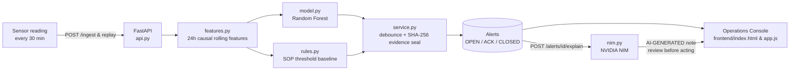
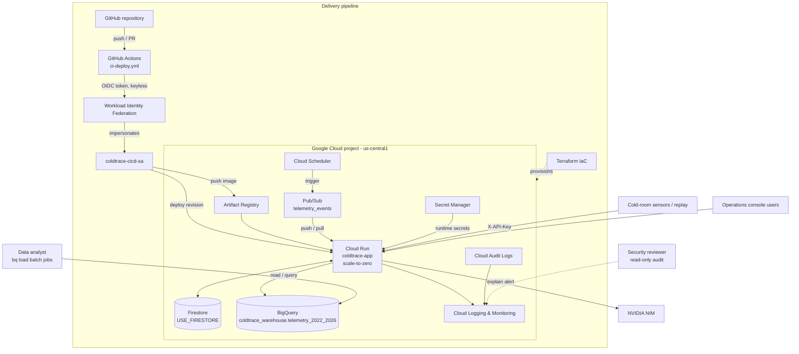
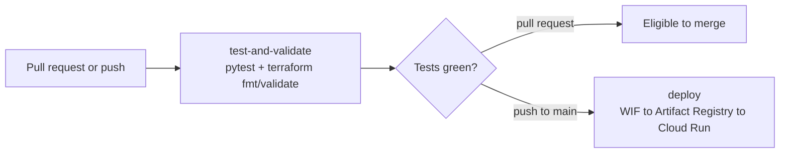

# ❄️ ColdTrace — AI Cold-Chain Operations & Spoilage Prevention Console


**Know before the product spoils.**

- **Live Console:** <https://coldtrace-app-644777661209.us-central1.run.app>
- **Research & Evaluation Summary:** [PROJECT_DOCS/RESEARCH_SUMMARY.md](PROJECT_DOCS/RESEARCH_SUMMARY.md)
- **Presentation Deck (8 slides):** [PROJECT_DOCS/ColdTrace — Cold-Chain Operations Console (1).pptx](<PROJECT_DOCS/ColdTrace — Cold-Chain Operations Console (1).pptx>)
- **Recorded Walkthrough (≤ 5 min):** *Add walkthrough link before final submission*
- **License:** MIT License (see [18. License](#18-license))

ColdTrace monitors refrigerated storage facilities in real time, detects temperature excursions, cooling failures, and sensor dropouts before spoilage occurs, links alerts to at-risk inventory batches, and generates grounded AI incident analyses via NVIDIA NIM.

---

## About ColdTrace

Vaccines, medicines, and perishable food lose value—and sometimes safety—the moment a cold room drifts out of its safe temperature band. In many distribution centers, problems such as a door left open, a failing compressor, or a frozen sensor are noticed only after inventory is already damaged, and fixed-threshold alarms fire so often that operators learn to ignore them.

ColdTrace is a cold-chain operations console that closes that gap. It ingests sensor readings every 30 minutes, scores them with a Random Forest anomaly detector alongside an SOP threshold baseline, and raises debounced alerts that move through an `OPEN → ACKNOWLEDGED → CLOSED` lifecycle. Each alert is sealed with a SHA-256 evidence hash over the exact triggering readings, so the record is tamper-evident. Operators can optionally request an NVIDIA NIM incident note, which is always labeled **AI-GENERATED, REVIEW BEFORE ACTING** and never acts on a case by itself.

**What it gives you**

- Early detection of temperature excursions, cooling failures, and sensor dropouts across multiple sites.
- Fewer false alarms through causal rolling features and alert debouncing.
- A calm, dark-mode control-room dashboard served directly by FastAPI.
- Tamper-evident evidence trails for quality reviewers and compliance auditors.
- A serverless, free-tier-first Google Cloud foundation, defined in Terraform and deployed through keyless CI/CD.

**Built with:** Python 3.12, FastAPI, scikit-learn (Random Forest), NVIDIA NIM, Google Cloud Run, Firestore, BigQuery, Pub/Sub, Secret Manager, Terraform, and GitHub Actions with Workload Identity Federation.

---

## 📑 Table of Contents

0. [About ColdTrace](#about-coldtrace)
1. [Problem, Audience & SDG Alignment](#1-problem-audience--sdg-alignment)
2. [System Architecture](#2-system-architecture)
3. [Repository Structure](#3-repository-structure)
4. [Detection Model & Exception Types](#4-detection-model--exception-types)
5. [Team, Roles & Responsibilities](#5-team-roles--responsibilities)
6. [IAM Access Matrix & Service Accounts](#6-iam-access-matrix--service-accounts)
7. [CI/CD & Infrastructure as Code](#7-cicd--infrastructure-as-code)
8. [Cost, Quota & Free-Tier Guardrails](#8-cost-quota--free-tier-guardrails)
9. [Data Warehouse Conventions](#9-data-warehouse-conventions)
10. [Environment Configuration & Secrets](#10-environment-configuration--secrets)
11. [Local Setup & Running Instructions](#11-local-setup--running-instructions)
12. [Google Cloud Run Deployment](#12-google-cloud-run-deployment)
13. [API Reference](#13-api-reference)
14. [Security & Design Guardrails](#14-security--design-guardrails)
15. [Security Practices & Secret Handling](#15-security-practices--secret-handling)
16. [Ownership Summary (RACI)](#16-ownership-summary-raci)
17. [Implementation Plan, Risk Register & Roadmap](#17-implementation-plan-risk-register--roadmap)
18. [License](#18-license)

---

## 1. Problem, Audience & SDG Alignment

| | |
|---|---|
| **Target audience** | Cold-chain operations leads, quality reviewers, and compliance auditors across **JHB-DC01** (`2°C–8°C` pharma band), **DBN-DC02** (`≤ 2°C` perishables), and **CPT-DC03** (last-mile facility with continuous audit). |
| **Problem** | Reactive cold-room monitoring detects temperature excursions, cooling failures, and sensor dropouts after warming or spoilage occurs, while noisy threshold blips cause alert fatigue and manual log stitching slows compliance audits. |
| **SDG alignment** | **UN SDG 3 — Good Health and Well-Being.** Prevents spoilage of temperature-sensitive vaccines, medicines, and perishable food by enabling early human intervention. |

### 1.1 Operational Evidence & Context

* **Cold-chain spoilage risk:** Unchecked temperature drift and cold-chain breaks across storage and transit risk potency loss, quarantine holds, or write-offs for pharmaceuticals, biologics, and perishables.
* **Operating bands & dataset:** Evaluates `2°C–8°C` (pharma/biologics) and `≤ 2°C` (perishables) across 30-minute telemetry intervals (`254,160` rows in `cold_chain_labeled_2022_2026.csv`).
* **Early intervention:** Catching drift and cooling degradation early gives operators time to inspect units, protect batches, or dispatch maintenance.

### 1.2 Friction Points & Console Mapping

| Friction Point | Operational Impact | ColdTrace Capability |
|---|---|---|
| **Late discovery** | Excursions noticed after warming or at shift handover | 30-min telemetry ingestion, 24h causal rolling features, Random Forest + SOP scoring, and CSV replay |
| **Alert fatigue** | Operators mute or ignore repetitive threshold blips | Causal rolling features, alert debouncing, and `Flagged` / `Watch` / `Cleared` band filters |
| **Audit trail gaps** | Slow manual reconstruction during QA/compliance reviews | `OPEN → ACKNOWLEDGED → CLOSED` lifecycle and tamper-evident `evidence_sha256` sealing |

### 1.3 Synthetic Telemetry & Evaluation Dataset

* **Dataset:** `cold_chain_labeled_2022_2026.csv` (`254,160` rows at 30-minute intervals across `JHB-DC01`, `DBN-DC02`, and `CPT-DC03`) models nominal operation, ambient/diurnal drift, `TEMP_EXCURSION`, `COOLING_FAILURE`, and `SENSOR_DROPOUT` scenarios without exposing live facility or confidential records.

---

## 2. System Architecture

ColdTrace runs a four-stage FastAPI pipeline paired with a control-room UI on serverless GCP infrastructure (`us-central1`), combining deterministic rules, Random Forest anomaly detection, SHA-256 evidence hashing, and human-reviewed NVIDIA NIM explanations.

### 2.1 Application Data Flow



### 2.2 Cloud Platform Architecture



### 2.3 Component Responsibilities

| Component | Purpose |
|---|---|
| **FastAPI (`api.py`)** | Serves the dashboard, authenticates requests, and exposes `/healthz`, `/ingest`, `/api/demo/replay`, alert lifecycle, and NIM endpoints. |
| **Feature engine (`features.py`)** | Causal 24-hour rolling features with zero look-ahead leakage. |
| **Detector (`model.py`, `rules.py`)** | Random Forest classifier plus SOP threshold baseline for comparison. |
| **Service layer (`service.py`)** | Streaming state, debouncing, `OPEN → ACKNOWLEDGED → CLOSED` transitions, and `evidence_sha256` sealing. |
| **NIM client (`nim.py`)** | Generates schema-validated incident notes labeled `AI-GENERATED, REVIEW BEFORE ACTING`. |
| **Cloud Run & GCP Services** | Hosts `coldtrace-app` (`us-central1`) with BigQuery (`coldtrace_warehouse`), Firestore (`USE_FIRESTORE`), Pub/Sub (`telemetry_events`), Secret Manager, and Terraform/WIF automation. |

---

## 3. Repository Structure

```text
coldtrace/
├── README.md                                              # Project overview, team, setup & submission links
├── LICENSE                                                # MIT License
├── env.example                                            # Sample environment variables (never commit .env)
├── PROJECT_DOCS/
│   ├── RESEARCH_SUMMARY.md                                # Research & evaluation summary
│   └── ColdTrace — Cold-Chain Operations Console (1).pptx # 8-slide presentation deck
├── terraform/                                             # Infrastructure as Code (project, IAM, WIF, budget)
├── .github/workflows/ci-deploy.yml                        # Tests, Terraform validate & WIF Cloud Run deploy
└── Backend/
    ├── coldtrace/                                         # FastAPI app, features, RF/SOP models, service, NIM, eval
    ├── frontend/                                          # Console UI (index.html, app.js)
    ├── data/cold_chain_labeled_2022_2026.csv              # Primary 2022–2026 dataset (254,160 rows)
    ├── artifacts/                                         # Trained Random Forest model & evaluation outputs
    ├── scripts/                                           # Data generation, training/eval, replay & NIM scripts
    ├── tests/                                             # Automated pytest suite
    ├── Dockerfile                                         # Production container for Cloud Run
    └── requirements.txt                                   # Python 3.12 dependencies
```

---

## 4. Detection Model & Exception Types

| Exception Type | Sensor Signature | Operational Action |
|---|---|---|
| `TEMP_EXCURSION` | Temperature exits safe band (`2°C–8°C` pharma/biologics; `≤ 2°C` perishables) with rising cooling load | Inspect unit immediately; protect/relocate at-risk batches |
| `COOLING_FAILURE` | Temperature rises while cooling load drops abnormally (compressor/cooling fault) | Dispatch maintenance; transfer high-sensitivity stock |
| `SENSOR_DROPOUT` | Sensor connectivity drops or temperature/humidity readings stall | Verify temperature manually; treat unit status carefully |

### Benchmark Summary ($N = 120$ Test Windows)

| Metric | Result |
|---|---|
| Random Forest macro-F1 ($N = 120$, 30 per class) | **0.918** |
| SOP threshold rules macro-F1 | **0.626** |
| AI triage role | Optional NVIDIA NIM note (`AI-GENERATED, REVIEW BEFORE ACTING`) |

---

## 5. Team, Roles & Responsibilities

**Team ColdTrace** divides ownership across four tracks:

* **Moorthy (DevOps & Cloud):** Owns GCP project/billing setup, Terraform IaC, keyless GitHub Actions CI/CD with Workload Identity Federation, Secret Manager rotation, Cloud Run deployments, and runtime reliability.
* **Chantell (Data Analytics):** Owns BigQuery batch loading (`bq load`), `Timestamp`-partitioned queries, schema checks, and telemetry quality/dropout validation.
* **Muedi (AI & Cloud Foundation):** Owns Random Forest anomaly detection, `N = 120` evaluation, NVIDIA NIM integration, and serverless Pub/Sub, Scheduler, Firestore, and Cloud Run foundations.
* **Peter (Security Review):** Performs read-only audits across IAM/WIF bindings, authentication/secret controls, Cloud Audit/Monitoring logs, and `evidence_sha256` integrity.

---

## 6. IAM Access Matrix & Service Accounts

### 6.1 Human Access Matrix

| Role / Permission | Moorthy | Chantell | Muedi | Peter |
|---|:---:|:---:|:---:|:---:|
| Project Owner & Billing Admin | ✅ | | | |
| `bigquery.jobUser` | | ✅ | ✅ | ✅ |
| `bigquery.dataEditor` (`coldtrace_warehouse` only) | | ✅ | | |
| `bigquery.dataViewer` | | | ✅ | ✅ |
| `run.developer`, `artifactregistry.writer`, `pubsub.editor`, `cloudscheduler.admin`, `datastore.user`, `iam.serviceAccountUser` | | | ✅ | |
| `secretmanager.viewer` (metadata only) | | | ✅ | ✅ |
| `iam.securityReviewer`, `logging.viewer`, `logging.privateLogViewer`, `monitoring.viewer` | | | | ✅ |

### 6.2 Service Accounts

| Service Account | Used By | Least-Privilege Scope |
|---|---|---|
| `coldtrace-runtime-sa` | Cloud Run (`coldtrace-app`) | Read/query BigQuery, Firestore & Pub/Sub access, Cloud Logging/Monitoring, and runtime Secret Manager access |
| `coldtrace-cicd-sa` | GitHub Actions (`ci-deploy.yml`) | Keyless WIF impersonation to push images and deploy Cloud Run revisions (no JSON keys) |

---

## 7. CI/CD & Infrastructure as Code

The pipeline lives in `.github/workflows/ci-deploy.yml`:

```text
git push ──► GitHub Actions (ci-deploy.yml) ──► OIDC token ──► Workload Identity Federation
                                                                      │
                                                         impersonate coldtrace-cicd-sa
                                                                      │
                                        ┌─────────────────────────────┴───────────────┐
                                        ▼                                             ▼
                              Build & push image                          Deploy Cloud Run revision
                              to Artifact Registry                        (runs as coldtrace-runtime-sa)
```

### 7.1 Pipeline Stages



### 7.2 Workflow & Guardrails

| Job / Control | Trigger / Scope | Behavior | Owner |
|---|---|---|---|
| `test-and-validate` | Push to `main`, PR, manual | Runs `pytest` and Terraform `fmt`/`validate` (blocks merge) | Moorthy |
| `deploy` | Push to `main` after checks, manual | Keyless WIF auth, Artifact Registry push, Cloud Run deploy | Moorthy / Muedi |
| WIF & Branch Protection | `Muedi-M/ColdTrace`, `main` branch | Repo-scoped WIF condition; PR + required check + no force push | Moorthy / Peter |

---

## 8. Cost, Quota & Free-Tier Guardrails

| Guardrail | Setting | Owner |
|---|---|---|
| Cloud Run idle cost | `--min-instances 0` (scale-to-zero) | Moorthy / Muedi |
| Cloud Run scaling & concurrency | Bounded instances/concurrency & memory limits | Moorthy / Muedi |
| Budget & quota review | Budget cap, alerts & ongoing quota checks | Moorthy |
| BigQuery batch loads | Free batch `bq load` jobs (no streaming inserts) | Chantell |
| BigQuery queries | Partition filter on `Timestamp` to bound scanned bytes | Chantell |
| Secrets & audit | Secret Manager only; no plaintext access for engineers | Moorthy / Peter |

---

## 9. Data Warehouse Conventions

Dataset: **`coldtrace_warehouse`** (`coldtrace_warehouse.telemetry_2022_2026`, `254,160` rows at 30-minute intervals across `JHB-DC01`, `DBN-DC02`, and `CPT-DC03`).

* **Batch load:** Use `bq load` jobs rather than streaming inserts.
* **Partitioning:** Filter queries on `Timestamp` to bound scanned bytes:
  ```sql
  SELECT Storage_Location_ID, AVG(Warehouse_Temperature_C) AS avg_temp
  FROM `coldtrace_warehouse.telemetry_2022_2026`
  WHERE Timestamp BETWEEN TIMESTAMP('2026-11-01') AND TIMESTAMP('2026-11-14')
  GROUP BY Storage_Location_ID;
  ```
* **Access & validation:** Dataset-scoped `dataEditor` for Data Analytics; read-only for other roles and Cloud Run runtime. Validates required columns, 30-minute cadence, non-null critical fields, exception labels (`NONE`, `SENSOR_DROPOUT`, `COOLING_FAILURE`, `TEMP_EXCURSION`), and warehouse schema columns (`Warehouse_Temperature_C`, `Warehouse_Humidity_Percent`, `Cooling_Load_Percent`, `Sensor_Connectivity`, `Exception_Type`, `Storage_Location_ID`, `Timestamp`).

---

## 10. Environment Configuration & Secrets

| Variable | Required | Description |
|---|---|---|
| `INGEST_API_KEY` | Yes | Shared key passed in `X-API-Key` for `/ingest`, `/api/demo/replay`, `/alerts/{id}/explain`, and case state routes |
| `NVIDIA_API_KEY` | Yes | NVIDIA NGC API key used by `coldtrace/nim.py` for incident explanations |
| `USE_FIRESTORE` | Optional | Enables Firestore persistence for alert state when configured |
| `NIM_MODEL` / `NIM_TIMEOUT` | Optional | Overrides default NVIDIA NIM model ID or request timeout |
| `MODEL_PATH` | Optional | Path to the trained Random Forest model artifact |

---

## 11. Local Setup & Running Instructions

1. **Create virtual environment & install dependencies**
   ```bash
   cd Backend
   python3 -m venv .venv
   source .venv/bin/activate
   pip install -r requirements.txt
   ```
2. **Set environment variables**
   ```bash
   cp ../env.example .env
   export $(grep -v '^#' .env | xargs)
   ```
3. **Run FastAPI & console UI**
   ```bash
   uvicorn coldtrace.api:app --reload --port 8000
   ```
   * Console UI: `http://localhost:8000`
   * Swagger docs: `http://localhost:8000/docs`
4. **Run unit tests**
   ```bash
   pytest -q tests
   ```

---

## 12. Google Cloud Run Deployment

Deploy `coldtrace-app` in `us-central1` with scale-to-zero and concurrency guardrails while binding runtime secrets from Secret Manager:

```bash
cd Backend
gcloud run deploy coldtrace-app \
  --source . \
  --region us-central1 \
  --allow-unauthenticated \
  --min-instances 0 \
  --max-instances 3 \
  --concurrency 10 \
  --memory 512Mi \
  --service-account coldtrace-runtime-sa@<PROJECT_ID>.iam.gserviceaccount.com \
  --set-secrets "INGEST_API_KEY=INGEST_API_KEY:latest,NVIDIA_API_KEY=NVIDIA_API_KEY:latest"
```

---

## 13. API Reference

| Method & Path | Auth | Purpose |
|---|---|---|
| `GET /` | Public | Serves the ColdTrace Operations Console web UI |
| `GET /healthz` | Public | Health check and active storage / Pub/Sub status |
| `POST /ingest` | `X-API-Key` | Ingests a 30-min reading, updates 24h causal rolling features, and evaluates alerts |
| `POST /api/demo/replay` | `X-API-Key` / Console | Replays `cold_chain_labeled_2022_2026.csv` into the streaming detector and syncs UI state |
| `GET /api/locations` & `GET /api/alerts` | Optional | Returns hub telemetry and alerts with `evidence_sha256` and lifecycle state |
| `POST /api/alerts/{id}/ack` & `/close` | `X-API-Key` | Transitions alerts through `OPEN → ACKNOWLEDGED → CLOSED` |
| `POST /alerts/{id}/explain` | `X-API-Key` | Generates a schema-validated NVIDIA NIM incident note (`AI-GENERATED, REVIEW BEFORE ACTING`) |

---

## 14. Security & Design Guardrails

* **Human-in-the-loop AI:** Primary anomaly detection never depends on the LLM; NVIDIA NIM notes are labeled `AI-GENERATED, REVIEW BEFORE ACTING` and never auto-acknowledge or auto-close alerts.
* **Tamper-evident evidence:** Triggering telemetry windows are hashed deterministically into `evidence_sha256`.
* **Constant-time auth & least privilege:** `X-API-Key` uses constant-time comparison; IAM roles and service accounts follow least privilege with read-only security auditing.
* **Keyless CI/CD & Secret Manager:** GitHub Actions uses OIDC/WIF with no JSON keys; runtime secrets live in Secret Manager.

---

## 15. Security Practices & Secret Handling

* Never commit `.env` or real secrets; keep `env.example` placeholder-only and enable GitHub secret scanning and push protection.
* Rotate keys via Secret Manager versions, roll out Cloud Run to `:latest`, verify behavior, and disable old versions.
* Run local checks before pushing:
  ```bash
  cd Backend && pytest -q tests && cd ..
  gitleaks detect --source . --redact --verbose
  terraform -chdir=terraform fmt -check -recursive
  ```

---

## 16. Ownership Summary (RACI)

**R** = Responsible, **A** = Accountable, **C** = Consulted, **I** = Informed

| Area | Moorthy | Chantell | Muedi | Peter |
|---|:---:|:---:|:---:|:---:|
| GCP project, billing, budget & Terraform IaC | **A/R** | I | C | C |
| GitHub Actions CI/CD (WIF) & Secret Manager | **A/R** | I | C | C |
| Container builds & Cloud Run (`us-central1`) | A | I | **R** | I |
| Random Forest model, evaluation & NIM client | I | C | **A/R** | I |
| BigQuery batch loads, partitions & data QA | I | **A/R** | C | I |
| Pub/Sub, Scheduler & Firestore pipelines | A | I | **R** | I |
| IAM/WIF audit, logs & evidence review | C | I | C | **A/R** |

---

## 17. Implementation Plan, Risk Register & Roadmap

### 17.1 Key Milestones

* **Core Detection & Console Workflow:** Category-aware safe bands (`2°C–8°C` pharma/biologics; `≤ 2°C` perishables), 24h causal rolling features, `OPEN → ACKNOWLEDGED → CLOSED` workflow, `evidence_sha256` sealing, and replay on `cold_chain_labeled_2022_2026.csv`.
* **Benchmarking, GCP & Security Controls:** Random Forest (`0.918` F1) vs. SOP rules (`0.626` F1) on `N = 120`, guarded NVIDIA NIM explanations, BigQuery (`254,160` rows) / Firestore / Pub/Sub integration, and WIF + Secret Manager + Gitleaks guardrails.
* **Submission Package:** Finalize `PROJECT_DOCS/RESEARCH_SUMMARY.md`, 8-slide deck (`PROJECT_DOCS/ColdTrace — Cold-Chain Operations Console (1).pptx`), recorded walkthrough (`≤ 5` min), and `README.md` links.

### 17.2 Risk Register

| Risk | Likelihood | Impact | Mitigation |
|---|---|---|---|
| **NVIDIA NIM API errors or rate limits** | Medium | Low | Keep Random Forest + SOP rules as primary detectors; label NIM notes for human review |
| **Cloud Run cost or quota spikes** | Low | Medium | Enforce `--min-instances 0`, instance/concurrency caps, and budget alerts |
| **Sim-to-real sensor gap** | Medium | High | Validate safe bands and calibrate physical probes before production rollout |
| **Secret exposure** | Low | High | Use Secret Manager, WIF, and Gitleaks checks; rotate immediately if exposed |
| **Cold starts during demos** | Medium | Low | Warm/verify endpoints before demos while keeping scale-to-zero enabled |

### 17.3 What's Next After BUILD

* Add the final `≤ 5`-minute recorded walkthrough link at the top of `README.md` and verify all submission links.
* Calibrate physical sensors across `JHB-DC01`, `DBN-DC02`, and `CPT-DC03` and pilot real-sensor streams toward multi-site rollout.

---

## 18. License

This project is licensed under the **MIT License**. See the [`LICENSE`](LICENSE) file in the repository root for full terms.

*ColdTrace is built for SDG 3: because a vaccine that spoils in the dark helps no one.*
